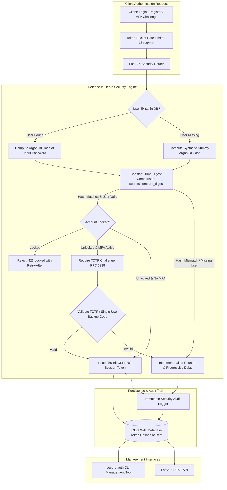

# Secure Authentication Service (`secure-auth`)

Production-Hardened Defense-in-Depth Authentication Microservice, Argon2id Password Hashing, Timing Side-Channel Immunity, TOTP Multi-Factor Authentication (RFC 6238), Progressive Account Lockout, and Immutable Audit Trails.

[](https://github.com/Krish9800/secure-authentication-service/actions)
[](https://opensource.org/licenses/MIT)
[](https://www.python.org/)
[](https://datatracker.ietf.org/doc/html/rfc9106)
[](https://datatracker.ietf.org/doc/html/rfc6238)

---

## Overview & Problem Statement

Authentication vulnerabilities remain a primary cause of high-profile data breaches. Common implementation flaws include outdated password hashing algorithms (MD5, SHA-1, un-salted SHA-256), username enumeration via observable response timing differences, lack of multi-factor authentication, and brittle lockout policies that allow automated credential stuffing or trigger denial-of-service against legitimate users.

**Secure Authentication Service (`secure-auth`)** is an educational, production-hardened defensive authentication microservice. Built using FastAPI and SQLModel/SQLite, it demonstrates how to engineer an enterprise identity service that neutralizes timing side-channel attacks, enforces memory-hard password hashing via Argon2id (RFC 9106), implements Time-Based One-Time Passwords (TOTP RFC 6238) with emergency single-use backup codes, applies progressive exponential account lockouts, and records immutable security audit logs.

---

## Architecture & Data Flow



---

## Verified Features & Capabilities

- **Argon2id Password Hashing (RFC 9106)**:
  - Configured with memory hardness ($64\text{ MB}$ / $65536\text{ KiB}$), time cost ($t=3$ passes), and parallelism ($p=4$ threads) to defeat GPU/ASIC offline cracking.
- **Timing Side-Channel Immunity**:
  - Eliminates user enumeration by performing constant-time string comparisons (`secrets.compare_digest`).
  - Computes a synthetic dummy Argon2id hash whenever a queried username does not exist, guaranteeing statistically indistinguishable response latencies for existing and non-existing accounts.
- **RFC 6238 TOTP Multi-Factor Authentication**:
  - Standard time-based one-time passwords with $\pm 30\text{s}$ clock-drift tolerance.
  - Secure generation and validation of single-use emergency backup recovery codes.
- **Progressive Account Lockouts**:
  - Enforces exponential lockout backoff delays upon repeated failed attempts, preventing high-speed credential stuffing without causing permanent account lockout denial-of-service.
- **CSPRNG Ephemeral Session Tokens**:
  - Generates 256-bit cryptographically secure pseudorandom session tokens.
  - Stores session tokens strictly as SHA-256 hashes at rest in the database, protecting active user sessions in the event of database snapshot disclosure.
- **Hardened HTTP Headers & Rate Limiting**:
  - IP-based token-bucket rate limiting (15 attempts/minute).
  - Strict security response headers (`Cache-Control: no-store`, `X-Content-Type-Options: nosniff`, `X-Frame-Options: DENY`).
- **Comprehensive Operator CLI**:
  - `secure-auth` CLI with subcommands for user administration, account unlocking, database initialization, and audit trail inspection.

---

## Technology Stack

- **Core & CLI**: Python 3.12+, Typer, Rich, Pydantic v2
- **REST API**: FastAPI, Uvicorn, Starlette
- **Data Persistence**: SQLModel, SQLAlchemy, SQLite (WAL mode)
- **Cryptography**: Argon2-cffi, Cryptography, PyOTP, Secrets
- **Quality & Assurance**: Pytest, Pytest-Asyncio, Ruff, Mypy (strict typing)
- **Containerization**: Rootless multi-stage Docker (`UID 10001`)

---

## CLI Reference & Operational Usage

The platform provides the `secure-auth` administration CLI:

```bash
# 1. Display active cryptographic parameters and security settings
secure-auth version

# 2. Initialize database schema and tables
secure-auth db init

# 3. Provision a new user account with Argon2id password hash
secure-auth user create --username "alice_admin" --email "alice@corp.example"

# 4. List registered user accounts and security lock statuses
secure-auth user list

# 5. Manually unlock an account and reset failed login counters
secure-auth user unlock "alice_admin"

# 6. Display immutable security audit log trail
secure-auth audit list --limit 30

# 7. Launch production-hardened REST API service
secure-auth serve --host 127.0.0.1 --port 8000
```

---

## REST API Control Plane

Start the FastAPI daemon directly or via CLI:

```bash
uvicorn secure_auth.api.app:app --host 127.0.0.1 --port 8000
```

Interactive OpenAPI specifications are available at `http://127.0.0.1:8000/docs`.

### Primary Endpoints

| Method | Endpoint | Description |
|:-------|:---------|:------------|
| `GET` | `/health` | Health status and database connectivity check |
| `POST` | `/api/v1/auth/register` | Register a new user account with Argon2id hash |
| `POST` | `/api/v1/auth/login` | Authenticate with credentials (timing-invariant) |
| `POST` | `/api/v1/auth/logout` | Revoke active session token |
| `POST` | `/api/v1/mfa/setup` | Generate TOTP secret and QR code for authenticator apps |
| `POST` | `/api/v1/mfa/verify` | Verify TOTP code and activate MFA for account |
| `POST` | `/api/v1/mfa/backup-codes` | Generate single-use emergency recovery codes |
| `GET` | `/api/v1/users/me` | Retrieve authenticated user profile and security posture |

---

## Installation & Setup

```bash
# Clone the repository
git clone https://github.com/Krish9800/secure-authentication-service.git
cd secure-authentication-service

# Create virtual environment
python3 -m venv .venv
source .venv/bin/activate

# Install dependencies in editable mode
pip install --upgrade pip
pip install -e ".[dev]"
```

---

## Testing & Quality Assurance

Run the test suite:

```bash
# Run pytest test suite
pytest

# Run tests with code coverage metrics
pytest --cov=secure_auth --cov-report=term-missing

# Run code style and lint checks
ruff check .
ruff format --check .

# Run static type verification
mypy src/secure_auth
```

---

## Security Model & Threat Boundaries

Documented in `docs/threat_model.md`:

- **Timing Invariance**: Neutralizes user enumeration and timing side-channels via constant-time digest equality and synthetic dummy Argon2id hash calculations for missing users.
- **Token Protection at Rest**: Session tokens are hashed with SHA-256 before storage in SQLite, neutralizing offline token replay if database records are leaked.
- **Least Privilege Runtime**: Docker images execute as unprivileged user `UID 10001` with drop-capabilities (`cap_drop: ALL`).

---

## Limitations & Known Issues

- **In-Memory Rate Limiting**: The built-in token-bucket rate limiter tracks client IPs in memory. In multi-instance deployments behind load balancers, an external distributed cache (e.g. Redis) is required.
- **Session Revocation Broadcast**: Single-node architecture invalidates sessions directly in the local database.

---

## License & Responsible Use

Distributed under the **MIT License** - see [LICENSE](https://opensource.org/licenses/MIT).

> [!NOTE]
> Designed as an educational reference architecture and defensive engineering project for secure authentication and timing attack mitigation.
