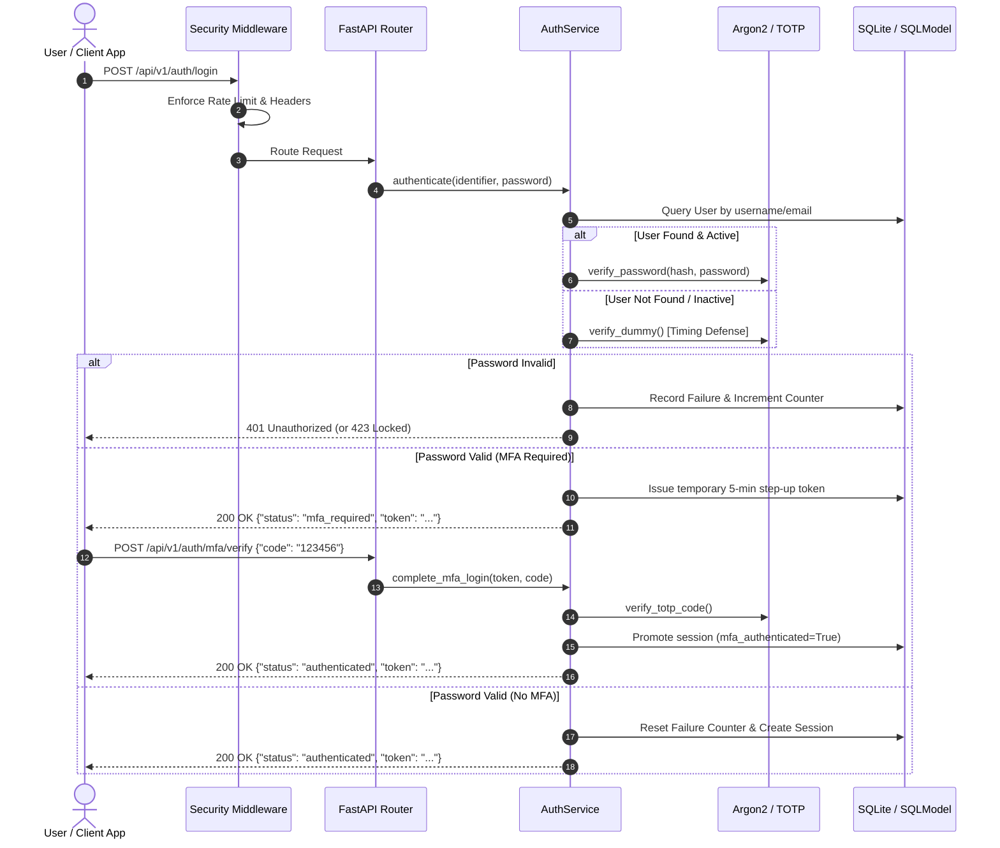

# Secure Authentication Service

[](https://github.com/Krish9800/secure-authentication-service/actions)
[](https://www.python.org/)
[](https://github.com/PyCQA/bandit)
[](https://mypy-lang.org/)
[](https://astral.sh/ruff)
[](LICENSE)

> **Educational Defensive Security Project (Cybersecurity Portfolio — Project 02)**  
> A production-grade, defense-in-depth authentication microservice demonstrating modern password hashing (Argon2id), timing side-channel mitigation, TOTP Multi-Factor Authentication (RFC 6238), progressive account lockouts, and structured security audit logging.

---

## 🔒 Security Posture & Architecture Guarantees

> [!IMPORTANT]
> **Core Cryptographic & Architectural Controls:**
> - **Argon2id (RFC 9106):** State-of-the-art password hashing with configurable memory-hardness ($64\text{MB}$), time cost ($t=3$), and parallelism ($p=4$) preventing GPU/ASIC brute-force economies.
> - **Timing Invariance:** Neutralizes user enumeration and timing side-channels via constant-time digest equality and synthetic dummy Argon2id hash calculations for missing users.
> - **Multi-Factor Authentication (MFA):** RFC 6238 compliant Time-Based One-Time Passwords (TOTP) with clock-drift tolerance ($\pm 30\text{s}$) and single-use emergency backup recovery codes.
> - **Progressive Account Lockouts:** Per-account progressive delays with exponential backoff mitigating automated credential stuffing without enabling permanent denial-of-service.
> - **Session Security:** 256-bit CSPRNG session tokens stored strictly as SHA-256 hashes at rest to prevent token exposure in database read breaches.
> - **Rate Limiting & Security Headers:** IP token-bucket rate limiting (15 auth attempts/min) and strict defense-in-depth HTTP headers (`no-store`, `nosniff`, `DENY`).
> - **Structured Audit Telemetry:** Tamper-evident immutable security events with automatic sanitization of sensitive cryptographic secrets.

---

## Architecture & Authentication Sequence



---

## Directory Structure

```
secure-authentication-service/
├── src/
│   └── secure_auth/
│       ├── api/             # FastAPI routers, schemas, dependencies, and middlewares
│       │   ├── routes/      # Endpoints (/auth, /mfa, /users)
│       │   ├── app.py       # Application factory & exception handlers
│       │   ├── dependencies.py # Session & auth dependency injectors
│       │   ├── middleware.py# Rate limiting & security response headers
│       │   └── schemas.py   # Strict Pydantic request/response models
│       ├── cli/             # Typer & Rich operational command-line interface
│       ├── config/          # Central settings (Argon2id, lockout, session params)
│       ├── core/            # Cryptographic core (Argon2id, TOTP, CSPRNG tokens)
│       ├── models/          # SQLModel entities (User, Session, RecoveryCode, Audit)
│       ├── services/        # Orchestration layer (Auth, MFA, Lockout, Audit)
│       └── storage/         # Database engine, connection pooling, and repositories
├── tests/
│   ├── unit/                # Unit tests for crypto, repositories, and services
│   ├── integration/         # REST API and CLI integration tests
│   └── security/            # Timing side-channel statistical verification
├── docs/
│   ├── architecture.md      # Detailed system design
│   ├── threat_model.md      # STRIDE threat model
│   ├── timing_attack_defense.md # Side-channel timing defense analysis
│   └── security_review.md   # Comprehensive defensive security audit
├── pyproject.toml           # Package configuration & tooling definitions
└── Dockerfile               # Production container image (non-root)
```

---

## Installation & Setup

### Requirements
- Python 3.12+
- `pip` and `virtualenv`

### Quick Start
```bash
# Clone repository
git clone https://github.com/Krish9800/secure-authentication-service.git
cd secure-authentication-service

# Create and activate virtual environment
python3 -m venv .venv
source .venv/bin/activate

# Install package and development tools
pip install -e ".[dev]"

# Initialize database schema
secure-auth db init
```

---

## Administrative CLI Usage

The service ships with a Rich-powered operational CLI `secure-auth`:

```bash
# View active security and cryptographic parameters
secure-auth version

# Launch REST API server
secure-auth serve --host 127.0.0.1 --port 8000

# Create a new user account (secure interactive password prompt)
secure-auth user create --username admin --email admin@example.com

# List registered accounts and security posture
secure-auth user list

# Unlock an account locked out due to failed attempts
secure-auth user unlock admin

# Display immutable security audit trail
secure-auth audit list --limit 25
```

---

## REST API Specification

### Authentication Routes (`/api/v1/auth`)

| Method | Endpoint | Description | Auth Required | Status Code |
| :--- | :--- | :--- | :--- | :--- |
| `POST` | `/api/v1/auth/register` | Register new account with Argon2id hash | None | `201 Created` |
| `POST` | `/api/v1/auth/login` | Authenticate credentials (returns session or challenge) | None | `200 OK` / `423 Locked` |
| `POST` | `/api/v1/auth/mfa/verify`| Complete MFA challenge to obtain full session | None | `200 OK` |
| `POST` | `/api/v1/auth/logout` | Revoke active bearer session token | Bearer Token | `200 OK` |
| `POST` | `/api/v1/auth/logout-all`| Revoke all active sessions across all devices | Bearer Token | `200 OK` |

### Multi-Factor Authentication Routes (`/api/v1/mfa`)

| Method | Endpoint | Description | Auth Required | Status Code |
| :--- | :--- | :--- | :--- | :--- |
| `POST` | `/api/v1/mfa/setup` | Generate TOTP secret and 10 emergency backup codes | Bearer Token | `200 OK` |
| `POST` | `/api/v1/mfa/confirm` | Confirm and permanently enable 2FA with live TOTP code | Bearer Token | `200 OK` |
| `POST` | `/api/v1/mfa/disable` | Safely disable 2FA after code verification | Bearer Token | `200 OK` |

### User Profile & Audit Routes (`/api/v1/users`)

| Method | Endpoint | Description | Auth Required | Status Code |
| :--- | :--- | :--- | :--- | :--- |
| `GET` | `/api/v1/users/me` | Fetch authenticated user profile | Bearer Token | `200 OK` |
| `GET` | `/api/v1/users/me/audit` | Fetch personal security audit history | Bearer Token | `200 OK` |

---

## Defensive Security Controls

### 1. Timing Side-Channel Defense
A classic vulnerability in web authentication is **user enumeration via response latency**. Because verifying an existing user's password takes $\approx 50\text{ms}$ of Argon2id hashing, missing users in naive implementations return in $< 1\text{ms}$, allowing attackers to map valid usernames.

`secure-authentication-service` eliminates this discrepancy:
- When a user is not found, `hasher.verify_dummy()` executes a full synthetic Argon2id verification cycle against an anchor hash.
- Latency between existing users with bad passwords and non-existent users is statistically indistinguishable ($1.0\times$ ratio).
- See detailed documentation in [docs/timing_attack_defense.md](docs/timing_attack_defense.md).

### 2. Progressive Lockout & Brute-Force Defense
- **Failure Threshold:** 5 consecutive failed login attempts.
- **Progressive Delay:** Base penalty of 300 seconds (5 minutes) scaling exponentially ($2^{\text{excess}}$) up to 24 hours.
- **Response:** Responds with HTTP `423 Locked` and RFC-standard `Retry-After` header.

### 3. Session Security
- Raw session tokens are **never** stored in the database.
- Database records only store `SHA-256(raw_token)`. Even if an attacker obtains a database snapshot, no active sessions can be hijacked.

---

## Testing & Quality Assurance

The codebase maintains strict quality thresholds:
- **Coverage:** $\ge 93\%$ statement coverage
- **Linting:** Ruff (PEP 8, Bugbear, Flake8-Security) with 0 errors
- **Type Safety:** Mypy strict mode with 0 errors
- **SAST:** Bandit security audit with 0 vulnerabilities

```bash
# Run full test suite with coverage
pytest --cov=secure_auth tests/

# Run Ruff linter and formatter
ruff check .
ruff format --check .

# Run Mypy strict type checker
mypy src/ tests/

# Run Bandit security scanner
bandit -r src/ -c pyproject.toml
```

---

## Docker Deployment

A lightweight, non-root Dockerfile is included:

```bash
# Build Docker image
docker build -t secure-auth:latest .

# Run container as non-root user (port 8000)
docker run -d -p 8000:8000 --name secure-auth-app secure-auth:latest

# Check service health
curl http://localhost:8000/health
```

---

## Responsible Security Disclosure

This project is created for educational and defensive cybersecurity purposes. If you discover a vulnerability in this project or have suggestions for enhancing cryptographic robustness, please review our [SECURITY.md](SECURITY.md) guidelines.
